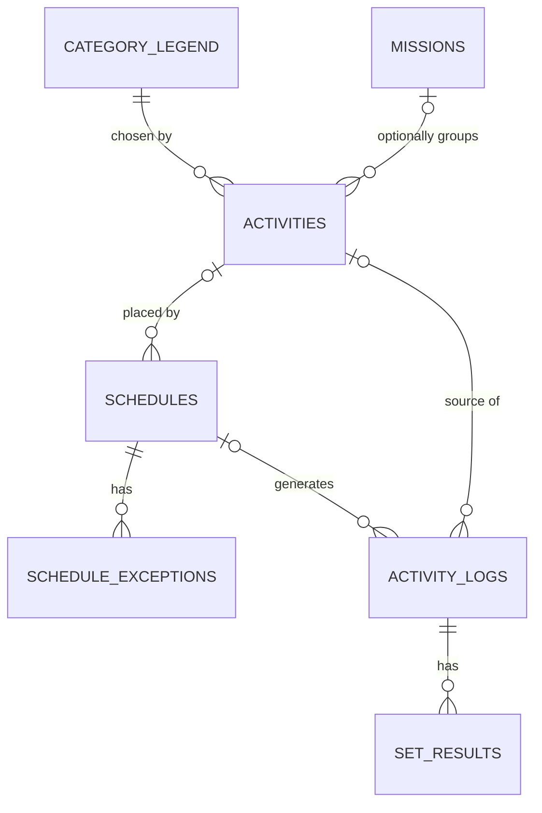

# Supabase schema design

Status: **Initial schema deployed** to the gym-tracker Supabase project on 30 October 2026. App authentication and syncing remain to be implemented.

## Plan versus log

- **Plan/schedule:** The current instructions for what should happen on a date or selected weekdays. The plan can be edited. Previous plan versions are not stored.
- **Date-specific schedule exception:** A change to one occurrence of a repeating plan, such as a different start time or target for one Thursday. It belongs to the plan and can be edited before that occurrence starts.
- **Activity log:** The dated record of what happened, including blank actual values for unmarked work. Logs are preserved after their date locks. A log contains the target that applied that day so its actual result remains understandable later.

## Scope

- One Google account uses the first release. Supabase Auth identifies that account. Database access and private media access must be restricted to it.
- Supabase Postgres stores app data. Supabase Storage stores one required image or GIF per created activity. There is no media-replacement feature in this release.
- The browser keeps an offline cache and a queue of unsynced changes. The queue entry and temporary upload are removed after successful sync; the cache remains.
- Analytics and challenges are outside the first release. The dated records retain the detail those features will later need.

## Relationships

`category_legend` is a lookup for the **category field** on an activity. Category is not a container or scheduler. A date-only activity created from Home has no `activities` or `schedules` row. It is a dated `activity_logs` entry and, for amount tracking, has `set_results` rows.

## Proposed tables

### `category_legend`

| Column | Type | Rule |
|---|---|---|
| `id` | UUID | Primary key |
| `name` | Text | Required; unique among active categories |
| `emoji` | Text | Required |
| `archived_at` | Timestamp, nullable | Hides an old choice without erasing history |
| `created_at`, `updated_at` | Timestamps | Audit fields |

The app seeds editable starter choices: 💪 Strength, 🏃 Cardio, 🧘 Mobility, 🏋️ Other.

### `missions`

| Column | Type | Rule |
|---|---|---|
| `id` | UUID | Primary key |
| `name` | Text | Required; unique among active Missions |
| `archived_at` | Timestamp, nullable | Hides an old Mission without erasing history |
| `created_at`, `updated_at` | Timestamps | Audit fields |

Missions have **no schedule fields** and no “Official Gym” flag.

### `activities`

Reusable activity definitions. Home-created date-only activities do not appear here.

| Column | Type | Rule |
|---|---|---|
| `id` | UUID | Primary key |
| `name` | Text | Required |
| `description` | Text | Required one-line description |
| `category_id` | UUID | Required reference to `category_legend` |
| `mission_id` | UUID, nullable | Optional reference to `missions` |
| `media_path` | Text | Required path in private Supabase Storage bucket |
| `tracking_method` | Enum | `yes_no`, `amount`, or `duration` |
| `amount_unit` | Text, nullable | Required for `amount`, e.g. `reps` or `km` |
| `target_segments` | JSONB, nullable | For `amount`: ordered positive targets, e.g. `[12,10,8]`; minimum one entry |
| `target_duration_minutes` | Integer, nullable | Required for `duration`; UI renders `hh:mm` |
| `archived_at` | Timestamp, nullable | Stops offering it for new schedules; history stays |
| `created_at`, `updated_at` | Timestamps | Audit fields |
| `revision` | Integer | Used to detect concurrent offline edits |

Exactly the target fields required by `tracking_method` must be present. `yes_no` has no numeric target. The image or GIF is immutable for this release.

### `schedules`

One row describes one placement of a reusable activity. A row is either for **one date** or a **repeating selection of weekdays**. Each repeating row has one start time shared by all selected weekdays.

| Column | Type | Rule |
|---|---|---|
| `id` | UUID | Primary key |
| `activity_id` | UUID | Required reference to `activities` |
| `kind` | Enum | `one_date` or `weekdays` |
| `on_date` | Date, nullable | Required only for `one_date` |
| `weekdays` | Smallint array, nullable | Required only for `weekdays`; 1=Monday through 7=Sunday |
| `start_time` | Time | Required; one time for the selected date or weekdays |
| `starts_on` | Date | First date the schedule applies |
| `ends_on` | Date, nullable | Last date the schedule applies; null means ongoing |
| `created_at`, `updated_at` | Timestamps | Audit fields |
| `revision` | Integer | Used to detect concurrent offline edits |

The repeating schedule is edited in place for future dates. No old schedule rows or schedule snapshots are kept. Past dated workout records are not rewritten.

### `schedule_exceptions`

One row changes or cancels **one date** of a repeating schedule. It does not preserve previous versions of the schedule.

| Column | Type | Rule |
|---|---|---|
| `id` | UUID | Primary key |
| `schedule_id` | UUID | Required reference to `schedules` |
| `on_date` | Date | The one occurrence being changed; unique with `schedule_id` |
| `is_cancelled` | Boolean | Whether this occurrence is removed from the plan |
| `start_time` | Time, nullable | Date-specific time, if changed |
| `target_segments` | JSONB, nullable | Date-specific amount targets, if changed |
| `target_duration_minutes` | Integer, nullable | Date-specific duration target, if changed |
| `mission_override_set` | Boolean | Distinguishes “clear Mission” from “no Mission change” |
| `mission_id` | UUID, nullable | Date-specific Mission, if changed |
| `display_order` | Integer, nullable | Date-specific order among activities sharing a start time |
| `created_at`, `updated_at` | Timestamps | Audit fields |
| `revision` | Integer | Used to detect concurrent offline edits |

The exception is editable only before that occurrence's start time. A null override means “use the regular schedule/activity value”; clearing an optional Mission requires an explicit override marker in the SQL design.

### `activity_logs`

One row per activity on one date, whether scheduled or created directly through Home. This is the **activity log**. It holds actual results and the target context needed to interpret them.

| Column | Type | Rule |
|---|---|---|
| `id` | UUID | Primary key; stable across offline sync |
| `activity_date` | Date | Required |
| `start_time` | Time | Start time that applied on this date |
| `activity_id` | UUID, nullable | Reusable source, if any |
| `schedule_id` | UUID, nullable | Source schedule, if any |
| `name`, `description` | Text | Planned details for this date |
| `category_id`, `category_name`, `category_emoji` | UUID/text | Category details recorded for this date |
| `mission_id`, `mission_name` | UUID/text, nullable | Optional Mission details recorded for this date |
| `media_path` | Text | Required media reference |
| `tracking_method` | Enum | `yes_no`, `amount`, or `duration` |
| `amount_unit` | Text, nullable | Snapshot for amount activities |
| `target_duration_minutes` | Integer, nullable | Target for this dated log |
| `actual_duration_minutes` | Integer, nullable | Entered duration; blank until saved |
| `yes_no_result` | Boolean, nullable | Yes, No, or unanswered |
| `done_at` | Timestamp, nullable | Last Done press for amount/duration; not used for Yes/No |
| `created_at`, `updated_at` | Timestamps | Audit fields |
| `revision` | Integer | Used to detect concurrent offline edits |

`activity_logs` is the dated activity log. A Home-created activity has null `activity_id` and `schedule_id`; it is otherwise structurally the same dated record. A change to one future occurrence belongs in `schedule_exceptions`, not in an old schedule version.

### `set_results`

One row for **every planned amount segment** on a date. For reps, a segment is a set. A 5 km walk has one segment in km.

| Column | Type | Rule |
|---|---|---|
| `id` | UUID | Primary key |
| `activity_log_id` | UUID | Required reference to `activity_logs` |
| `segment_number` | Integer | 1, 2, 3…; unique within the dated activity |
| `unit` | Text | e.g. `reps` or `km` |
| `target_amount` | Numeric | Required, greater than zero |
| `actual_amount` | Numeric, nullable | Blank means unrecorded; zero is distinct from blank |
| `created_at`, `updated_at` | Timestamps | Audit fields |
| `revision` | Integer | Used to detect concurrent offline edits |

The plan must have at least one segment and a target for every segment. The user may press the single activity-level Done button after entering only some actual values. A later Done press updates the total actual values. Blank actuals remain blank in the database. The UI derives pending versus skipped from the date lock; no “skipped” value overwrites the blank.

### `settings`

| Column | Type | Rule |
|---|---|---|
| `id` | Boolean | Singleton key; one row |
| `owner_auth_user_id` | UUID | The one approved Supabase Auth account for this release |
| `tracker_time_zone` | Text | Required IANA time zone, detected from the first device at setup and editable later |
| `updated_at` | Timestamp | Audit field |
| `revision` | Integer | Used to detect concurrent offline edits |

One time zone setting applies to all app data. No per-record historical time-zone field is proposed.

## Media and access

- One private Supabase Storage bucket stores images/GIFs. `media_path` holds an object path, not a public URL.
- The first release allows one approved Google account through Supabase Auth. Database policies and Storage policies restrict reads and writes to that account. No multi-user ownership columns are proposed for this release.
- An archived activity keeps its media while history refers to it. Media replacement is not in scope.

## Materializing dates

The app creates `activity_logs` and `set_results` records for each scheduled date, including days the user never opens. A small server-side daily task can create them from the current schedule plus any date-specific exception. Before editing a repeating schedule, the app ensures that any missing past dates have been logged under the plan that applied to them. The schedule itself is then edited in place. Once a date has locked at midnight in the configured tracker time zone, its log records cannot be changed through the app.

## Offline sync

The browser stores cached records and pending operations in IndexedDB. It uses stable UUIDs so the same offline-created record can be inserted once when online. Operations that touch different records can sync independently. A revision mismatch on the same record triggers a conflict prompt; the app must not silently overwrite one device’s result. Successfully synced queue items and temporary media blobs are removed, while the compact cache remains for future offline use.

## Items needing explicit review before SQL migration

1. **Amount target storage:** Reusable `activities` keep ordered targets in JSONB; each dated target becomes a separate `set_results` row for tracking and analytics.
2. **Date and time behavior:** The schema stores local date and local start time, and one current tracker time zone. The precise behavior when the time zone setting changes must be fixed before implementation.
3. **Drag ordering:** Home must remain in start-time order. The mockup leaves open whether dragging changes an activity's start time or only orders activities that share a start time.
4. **Access setup:** The approved Google account and Supabase project credentials will be provided during implementation; they are not stored in this document.
